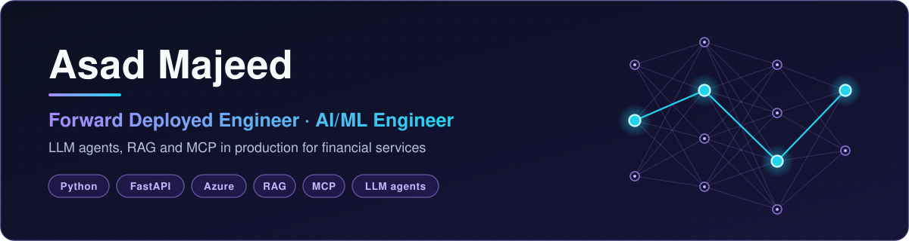

<picture>
  <source media="(prefers-color-scheme: dark)" srcset="assets/hero-dark.svg">
  <source media="(prefers-color-scheme: light)" srcset="assets/hero-light.svg">
  
</picture>

 

I build and deploy LLM agents and RAG systems inside enterprise clients' own cloud environments, and I own the AI side of the deployment end to end.

I work with AsbiTech in Dubai through Deepixel. I build the AI layer of Invictus, a wealth-management suite, and work as a Forward Deployed Engineer with an enterprise asset management client.

  
  
  

## What I work on

| Area | Work |
| :--- | :--- |
| **Agents and MCP** | Built the first Deals MCP server: read-only tools that let AI agents query deal data according to each user's organisation and role. |
| **RAG and document intelligence** | Led the implementation of a RAG gateway that answers questions and extracts structured fields from financial documents. Extraction accuracy went from 60.4% to 73.6% against a golden dataset. |
| **LLM observability** | Maintain a self-hosted fork of Langfuse on private Kubernetes clusters, with keyless deployment pipelines. |
| **On-device AI** | Build a privacy-first desktop meeting assistant in Rust and Tauri. Transcription and speaker identification run on the user's own laptop. |

Most of this work lives in private repositories.

## Public work

<table>
  <tr>
    <td width="50%" valign="top">
      <h3><a href="https://github.com/ASAD-BE18/solar-heat-guard">SolarGuard</a></h3>
      
FortyGuard Hackathon'26, built with Mariam Qusai. Ranks every stretch of every solar panel row by heat exposure, so an operator knows where to look first.

      
<a href="https://asad-be18.github.io/solar-heat-guard/">Live map</a> · <code>Python</code> <code>GeoJSON</code> <code>Leaflet</code>

    </td>
    <td width="50%" valign="top">
      <h3><a href="https://github.com/ASAD-BE18/LLM-Series">RAG from scratch</a></h3>
      
A runnable Colab notebook: a small end-to-end RAG example with a local model and a vector store. No API keys needed.

      
<code>Python</code> <code>LangChain</code> <code>Chroma</code>

    </td>
  </tr>
  <tr>
    <td width="50%" valign="top">
      <h3><a href="https://github.com/ASAD-BE18/agritwin">AgriTwin</a></h3>
      
Team capstone for the CATCH_VR Summer School 2026: a small IoT greenhouse rig with a live digital twin and an LLM chat on top. I built the FastAPI backend and the MCP server.

      
<code>FastAPI</code> <code>MCP</code> <code>Arduino</code>

    </td>
    <td width="50%" valign="top">
      <h3>Publications</h3>
      
<a href="https://doi.org/10.1109/icit63607.2024.10860145">Weed and Cotton Crop Classification Using YOLO and Faster RCNN</a>, IEEE ICIT 2024.

      
<a href="https://doi.org/10.1109/icit59216.2023.10335840">A Review of Algorithm's Complexities on Different Valued Sorted and Unsorted Data</a>, IEEE ICIT 2023.

    </td>
  </tr>
</table>

## Stack

| Area | Tools |
| :--- | :--- |
| **AI and LLM** | RAG, MCP, LangGraph, Azure OpenAI, Azure AI Search, Azure Document Intelligence, Langfuse, whisper.cpp |
| **Backend** | Python, FastAPI, PostgreSQL, MySQL |
| **Frontend and desktop** | TypeScript, React, Next.js, Rust, Tauri |
| **Cloud and DevOps** | Azure (AKS, Functions, Container Apps), Kubernetes, Helm, Docker, GitHub Actions, Terraform |

## Background

- MS in Computer Engineering, GIKI. Thesis: forecasting wheat yield from Landsat satellite imagery.
- BE in Electrical Engineering, Sukkur IBA University.
- Four years as a freelance Python developer on [Fiverr](https://www.fiverr.com/asadmajeed98) and [Upwork](https://www.upwork.com/freelancers/~0174204136779fce74) before joining Deepixel.
